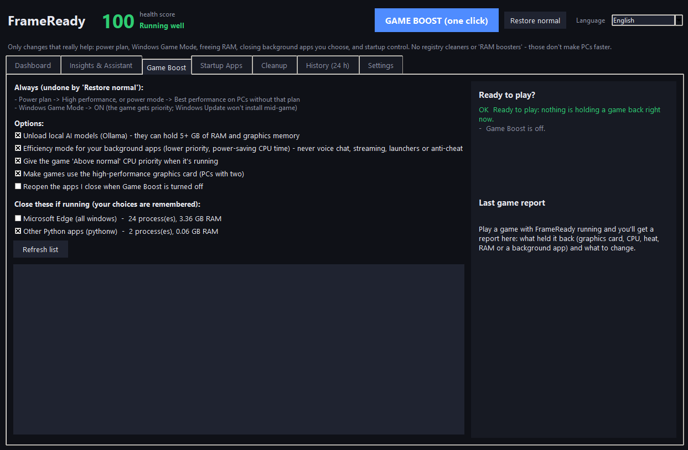
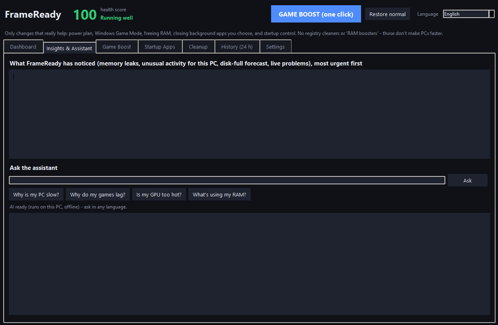
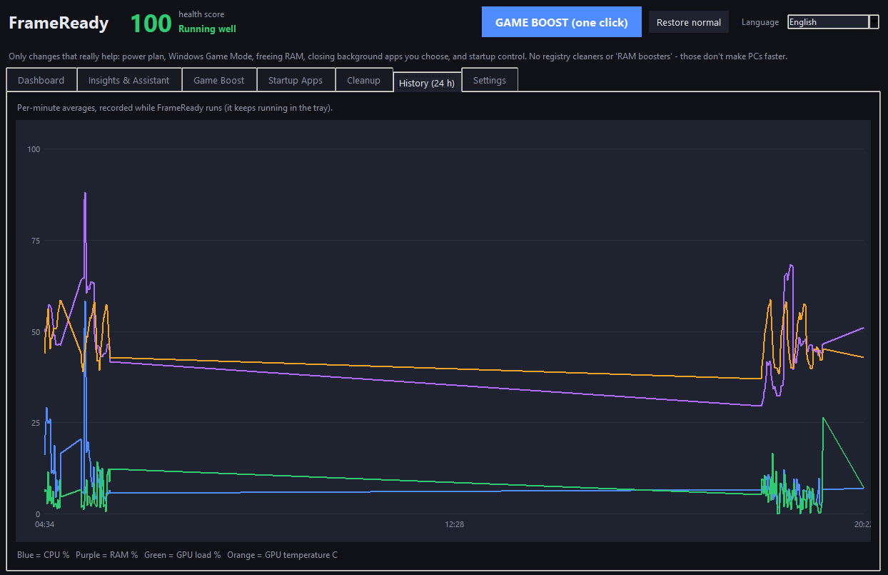

# FrameReady: honest PC health monitor and one-click Game Boost for Windows

**Website, screenshots and virus scan report: https://dragon12367.github.io/frameready/**
**Get it (CA$4.20, pay once): https://frameready.gumroad.com/l/frameready**

FrameReady is a small Windows 10/11 app. It shows you in plain English what's slowing your PC down, catches apps that leak memory, and gets your PC ready for gaming in one reversible click.

## Game Boost
- High performance power plan, or *Best performance* power mode on laptops without that plan
- Monitors set to native resolution at their highest refresh rate, fixing a 144/165/180 Hz screen stuck at 60 Hz
- Windows Game Mode and "Optimizations for windowed games" on
- Optional: mouse acceleration off while you play
- The game gets *Above normal* CPU priority
- Background apps go into Efficiency mode, the same as Task Manager's. Voice chat, streaming, launchers and anti-cheat are never touched.
- On laptops with two graphics chips, games use the fast one
- Closes the background apps you pick, and can reopen them afterwards
- Auto-boosts when a game starts
- **Restore normal undoes the rest** (the monitor and windowed-games improvements stay on)

## After-game report
Shows what held each game back: the graphics card, CPU, heat, RAM, graphics memory, or a background app. Then it tells you what to change.

## Also
- Live dashboard with a 0–100 health score, and processes grouped into real apps
- Memory-leak detector and disk-full forecast
- A private assistant you can ask "why do my games lag?". It works offline, and an optional local AI adds answers in 11 languages.
- Startup apps manager and safe temp cleanup

## What it does NOT do
No registry "cleaning", no fake "RAM boosters", no disabling Windows services or security, no telemetry, no subscription.

This repository hosts the FrameReady website. The app itself is sold on [Gumroad](https://frameready.gumroad.com/l/frameready).
